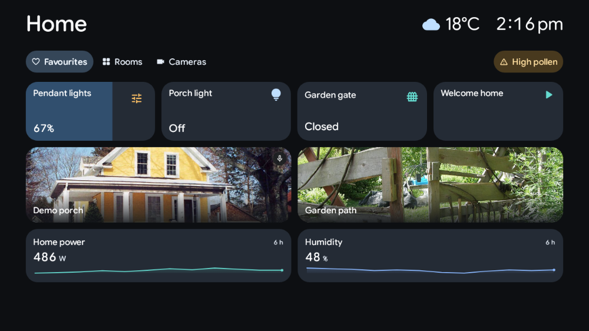
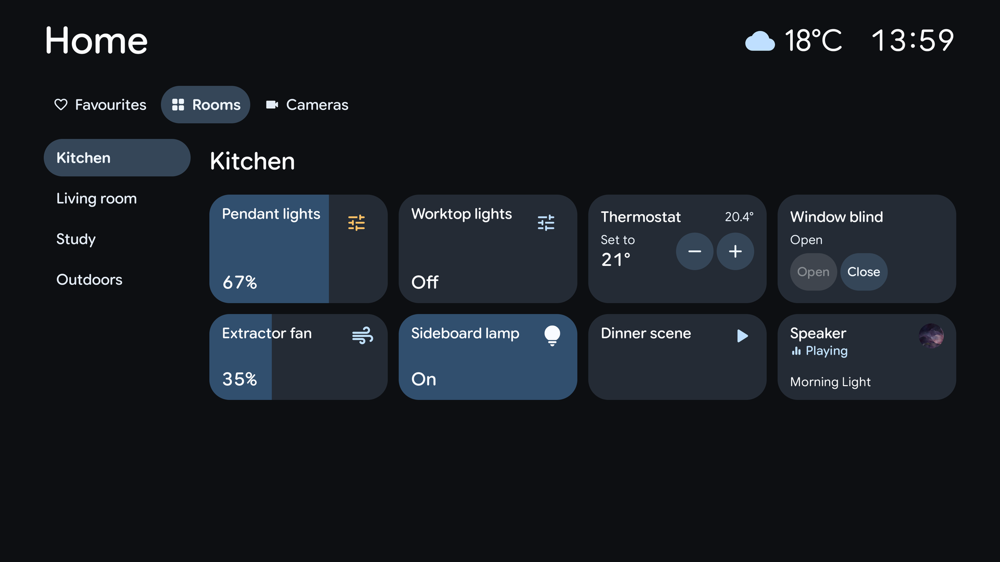
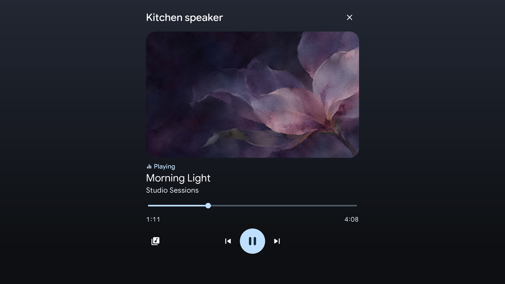
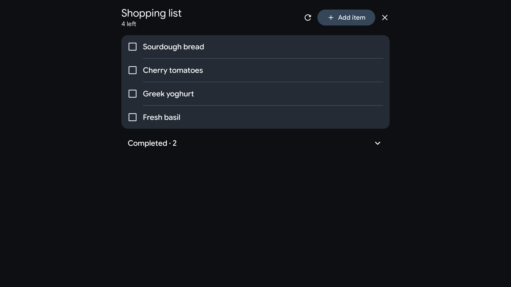
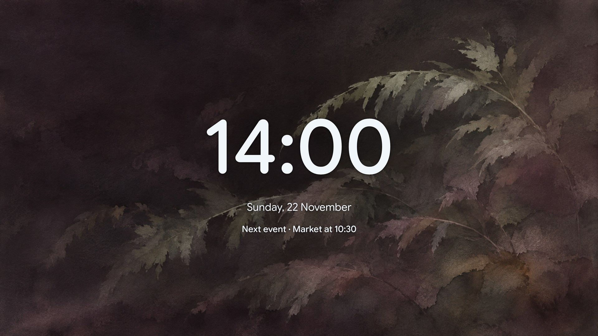

# Flick Panel

Flick Panel is a Home Assistant dashboard for Android tablets. Put the lights, blinds and scenes you use every day on Favourites, keep the rest in their rooms, and use the tablet as a photo clock when it’s idle.

[Download for Android](https://github.com/alphasixtyfive/flick-panel/releases/latest) · [User manual](docs/manual.md) · [Camera intercom](docs/intercom.md) · [Home Assistant integration](https://github.com/alphasixtyfive/flick-panel-home-assistant)

## What you can do

- Arrange Favourites and rooms with lights, switches, fans, covers, thermostats, scenes, and Android app shortcuts.
- Watch live cameras and use Talk on supported doorbells and cameras. Add controls for nearby lights, gates, or automations.
- Play and browse music, check off shopping items, see upcoming events, and open recipes or other Home Assistant text.
- Show sensor readings, percentages, graphs, weather, and alerts. Use the idle screen as a clock or photo frame.

## Example setups

- **Kitchen panel.** Keep a light dimmer, the shopping list, the shared calendar and the kitchen speaker on Favourites. Put the rest of the lights, blinds and thermostat in the Kitchen room.
- **Hallway panel.** Put a gate control and porch light on Favourites. Add those controls to the doorbell viewer so they’re within reach during a call.
- **Desk panel.** Pin a power graph and humidity reading, then add an alert for a sensor that needs attention. Use the idle clock to show the next appointment.

Start with the [example layout in the manual](docs/manual.md#example-kitchen-layout).

## Get started

Flick Panel requires Android 9 or later. Install the APK, enter your Home Assistant address and a long-lived access token, then set a PIN for editing. Hold **Home** in Flick Panel to return to setup.

The [user manual](docs/manual.md) covers connection, editing, cameras, room layouts, photos, backups, and tablet actions. The optional Home Assistant integration adds a display switch and actions for automations.

## Screenshots

<table>
  <tr>
    <td width="50%"></td>
    <td width="50%"></td>
  </tr>
  <tr>
    <td><strong>Rooms</strong> Keep the controls for each room together.</td>
    <td><strong>Music</strong> See what’s playing, skip tracks and seek.</td>
  </tr>
  <tr>
    <td></td>
    <td></td>
  </tr>
  <tr>
    <td><strong>Tasks</strong> Check off a shared Home Assistant list.</td>
    <td><strong>Photo clock</strong> Show an album and a message while the panel is idle.</td>
  </tr>
</table>

[See all screenshots](docs/screenshots/) including the calendar, music library and appearance settings. See the [intercom guide](docs/intercom.md) for the camera viewer and the microphone controls. The feature screenshots use a demo Home Assistant setup.

## Project

[Build and release instructions](docs/development.md) · [Report an issue](https://github.com/alphasixtyfive/flick-panel/issues) · [License](LICENSE)
