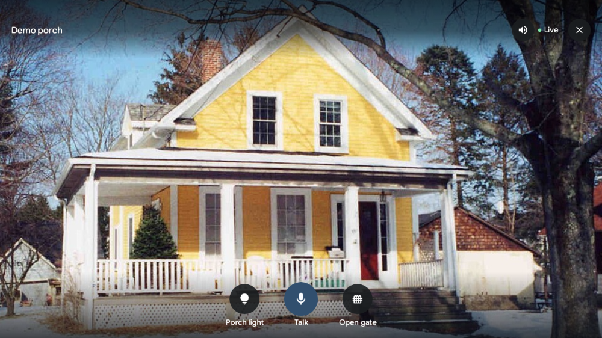

# Camera intercom

Pin a doorbell or camera to Favourites to see its preview at a glance. A microphone badge marks cameras configured for two-way audio. Tap the camera to open the full-screen viewer. The name sits on the left, with the live status and Close on the right. Talk and any controls you’ve added sit below the video.

[](screenshots/intercom.png)

The example uses a public-domain still in the Flick Panel viewer. [Porch photograph by Marcbela](https://commons.wikimedia.org/wiki/File:Gablefront2.jpg)

## Set up the camera

1. Add the camera in Home Assistant and confirm that its live stream works. For native two-way audio, the camera and its integration must support it and the stream must use WebRTC. Enable **Two-way audio** in **Settings → System → Labs** when required by your Home Assistant version. [Home Assistant camera guide](https://www.home-assistant.io/integrations/camera/#two-way-audio)
2. On Flick Panel, hold **Home** and enter the setup PIN. Open **Cameras** and select the camera. Turn on **Pin to Favourites** to put its preview on the home screen.
3. If your Home Assistant camera exposes a separate feed for viewing, choose it under **Live stream source**. Use **Test connection** to check that video starts and whether Talk is ready. The test leaves the microphone and camera actions idle.
4. Save your changes. Open the camera from Favourites or from the Cameras tab.

Flick Panel prefers native Home Assistant two-way audio when the camera advertises it. If you already use the WebRTC Camera integration, you can enter a named stream in **go2rtc fallback (optional)**. When the viewer falls back to HLS, you can still watch and hear the stream if it carries sound. Talk needs a working two-way WebRTC route. [WebRTC Camera integration](https://github.com/AlexxIT/WebRTC)

## Answer someone at the door

- **Listen.** Camera sound starts automatically when the stream carries audio. Use the speaker button to mute or unmute it.
- **Talk.** Tap **Talk** and allow Android microphone access on first use. When the microphone is active, the header shows **Live · Mic on** and the button changes to **End call**.
- **Finish.** Tap **End call** to switch the microphone off and keep watching. Closing the viewer or leaving the app releases it too.

[](screenshots/intercom-talking.png)

## Put the porch light and gate in the viewer

1. Edit the camera in setup and open **Camera actions**.
2. Add your porch light and your gate cover. A light button toggles its current state. A gate button follows the state Home Assistant reports, so the viewer offers the appropriate action.
3. Tap an action to give it a short label or choose an icon. Reorder the actions so the controls you reach for most are easiest to find.

A camera can have up to three actions. You can also choose a Home Assistant scene, script, or button. For example, add a scene that lights the entry path, or a script that runs the same sequence you already use to let a visitor in.

## Open the viewer when the doorbell rings

With the optional [Flick Panel Home Assistant integration](https://github.com/alphasixtyfive/flick-panel-home-assistant), an automation can open a saved camera on a linked panel while Flick Panel is in the foreground. The viewer opens in listening mode. Tap **Talk** on the panel when you’re ready to speak.

Change the example entity IDs to match your doorbell and camera. In the Home Assistant automation editor, select your linked panel in the **Open camera** action.

```yaml
alias: Show the porch when the doorbell rings
triggers:
  - trigger: state
    entity_id: binary_sensor.porch_doorbell
    from: "off"
    to: "on"
actions:
  - action: flick_panel.open_camera
    data:
      device_id: YOUR_LINKED_PANEL_DEVICE_ID
      camera_entity_id: camera.porch
```

## If Talk is unavailable

- Start with **Test connection**. For native two-way audio, check that the same camera offers **Start talking** in Home Assistant and that it is using WebRTC.
- If Android denied microphone access, open Flick Panel’s app permissions and allow **Microphone**.
- If the camera uses a separate viewing feed, check that the selected feed supports talkback or set the named go2rtc fallback. Use **Retry intercom** when the viewer offers it.

The viewer can show the last camera preview while it connects. **Live** appears after video starts. See the [user manual](manual.md#cameras-and-talkback) for preview cache behaviour.
